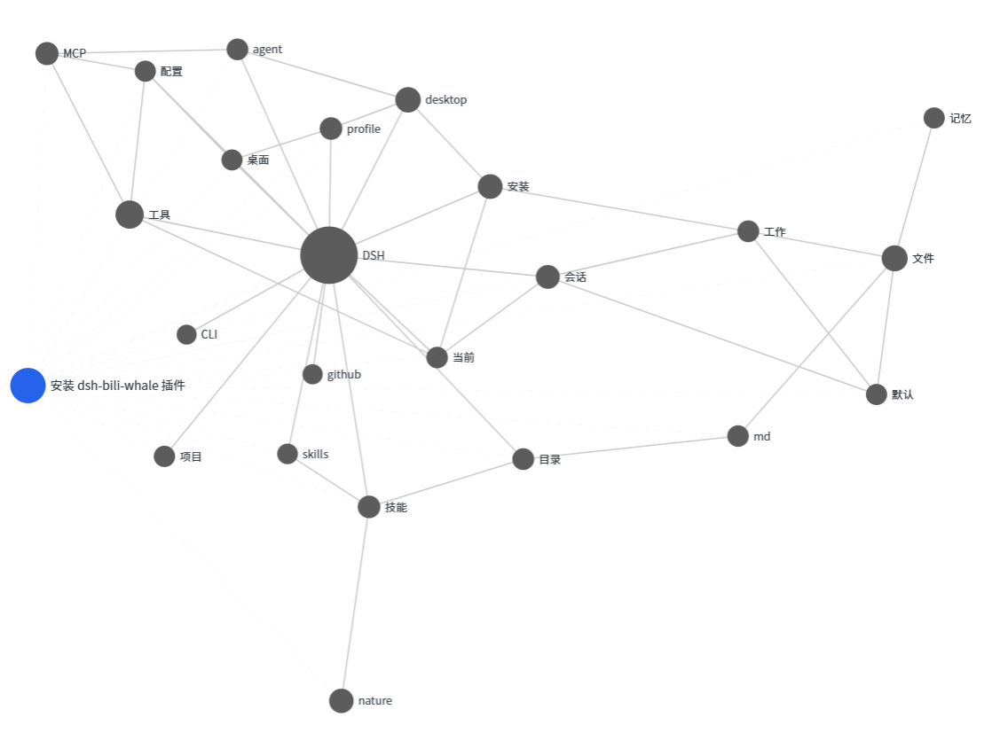

# dsh-Keyword-graph

DSH 插件：在会话顶栏加一个「图谱」标签，把当前会话的主题画成点线图。点主题能看到相关消息并跳回原文，也可以手动关联其他会话，合成一张跨会话图谱。

## 效果预览



## 效果

- 顶栏多一个「图谱」标签：当前会话的主题画成一张可拖拽的点线图，出现越多的词节点越大，同一段话里常一起出现的词连得越紧。
- 悬停节点看关键词、出现次数和原文语境；点击主题，右侧按轮列出相关消息，默认只显示关键词附近几行，点开看全文。
- 点轮次右侧「↗」跳到对话页对应位置；切回「图谱」时保留上次的视角和选中主题。
- 右侧「相关会话」可按共享主题推荐其他会话，点「关联」把它们并进同一张图，可随时取消。
- 发新消息后几秒内图谱自动更新；明暗主题跟随系统 / DSH 配色。

## 安装

要求：DSH 桌面版（自带 Node 24），不用自己装 Node。

### 方式一：从 GitHub 安装

本机需要有 `git`（pnpm 拉仓库要用）。

- 装了插件市场（dshmarket）的：在市场的「从 GitHub 安装」里填
  ```
  github:<你的GitHub用户名>/dsh-Keyword-graph
  ```
- 有 `dsh` 命令行的：
  ```
  dsh plugin --profile desktop add "github:<你的GitHub用户名>/dsh-Keyword-graph"
  ```

装完**完全退出 DSH（含托盘）再启动**。打开任意会话，顶栏出现「图谱」标签即成功。

卸载：

```
dsh plugin --profile desktop remove dsh-keyword-graph
```

或在插件管理里禁用 / 删除。

### 方式二：从 npm 安装（暂未发布）

```
dsh plugin --profile desktop add dsh-keyword-graph
```

> npm 包名必须全小写，所以包名是 `dsh-keyword-graph`；`dsh-Keyword-graph` 只是仓库/展示名。
> 目前尚未发布 npm，发布后这里直接可用。

### 方式三：本地 link

以 Windows 为例，`<仓库路径>` 为本仓库的绝对路径：

1. 建立插件目录 junction：

   ```bat
   cmd /c mklink /J "%USERPROFILE%\.dsh\plugins\dsh-keyword-graph" "<仓库路径>"
   ```

2. 编辑 `%USERPROFILE%\.dsh\profiles\desktop\package.json`：
   - `dependencies` 中加入 `"dsh-keyword-graph": "link:C:/Users/<用户名>/.dsh/plugins/dsh-keyword-graph"`（正斜杠路径）；
   - `dsh.profile.bundles` 数组末尾加入 `"dsh-keyword-graph"`。

3. 建立 profile 内的 node_modules junction：

   ```bat
   cmd /c mklink /J "%USERPROFILE%\.dsh\profiles\desktop\node_modules\dsh-keyword-graph" "%USERPROFILE%\.dsh\plugins\dsh-keyword-graph"
   ```

4. 完全退出 DSH（含托盘）后重新启动生效。启动日志出现 `[keyword-graph] 已挂载：/dsh-graph/api …` 即安装成功。

回滚：`rmdir` 删除上述两个 junction（不会动源文件），并还原 package.json 的两处修改。

> 数据目录和接口路径保持中性名：索引存在 `~/.dsh/dsh-graph/`，接口是 `/dsh-graph/api`。改名不影响已有数据。


## 使用

1. 打开任意会话，点顶栏「图谱」标签。首次进入会显示「索引中…」，稍等自动出图。
2. 悬停节点看详情；点击主题节点，右侧按轮列出相关消息，点消息展开全文，再点收起。
3. 要看原文时，点轮次右侧的「↗」跳到对话页对应轮次。
4. 在右侧「相关会话」中点「关联」，把其他会话并入图谱；已关联的显示「取消关联」，也可右键图谱里的会话节点取消。
5. 回到对话页发新消息后再看图谱，几秒内自动更新。

## 配置

配置文件：`~/.dsh/dsh-graph/config.json`（不存在时使用默认值，可直接创建 / 编辑）。

| 键 | 类型 | 默认值 | 说明 |
| --- | --- | --- | --- |
| `extraStopwords` | `string[]` | `[]` | 额外停用词，命中的词不进主题图谱 |
| `topN` | `number` | `25` | 每个会话保留的主题词数，通过 API 修改时自动收敛到 1–30；手工编辑请保持在此范围 |
| `accent` | `string` | `"#2563eb"` | 选中 / 高亮强调色（暗色主题默认 `#5b8cff`） |

示例：

```json
{ "extraStopwords": ["好的"], "topN": 20, "accent": "#2563eb" }
```

## 隐私

- 所有数据仅存本机 `~/.dsh/dsh-graph/`（索引、关联、配置），不上传任何内容。
- 索引只保存关键词、词频、10 字上下文描述、词距关系、每条消息 80 字摘要及标题/时间/轮次等元数据。选中主题时，从 DSH 本地会话文件按需截取关键词前后约 480 字的原文片段；展开某条消息时再读取该条全文。片段和全文都只留在页面内存，不写入索引、不上传。后台解压后的消息也只做进程内缓存（最多 4 个会话），DSH 退出即消失。定位跳转只使用轮次。
- 参与分词的只有真人发言（会话记录 `source.kind = "user"`）和 AI 的最终文本回复；DSH 注入的 system-reminder、技能目录、运行时快照、时间上下文、后台任务通知，以及 AI 思考过程（reasoning）和工具调用都不会进入关键词与摘要。助手正文开头偶发的时间上下文前缀行也会被剥掉。
- HTTP 路由 `/dsh-graph/api` 沿用 DSH 信任栅栏：仅回环 / DSH 信任来源可访问；信任服务不可用时拒绝访问（fail-closed）。

## 开发

开发 / 测试需 Node 22.15+（测试用 `zlib.zstdCompressSync`）；插件运行时用的 Node 由 DSH 自带。

```bash
npm test          # node --test，100 项测试
```

零原生依赖：zstd 解压优先用 Node 内置的 `zlib.zstdDecompressSync`（DSH 桌面版自带 Node 24）。注意 DSH 会话文件是多帧 zstd 拼接，而 Electron 44 内置的 Node 24.21 对整包只解第一帧、不报错，所以这里先按 RFC 8878 帧格式切开再逐帧解压；运行时没有该能力（或帧解析失败）就自动回退纯 JS 的 fzstd 整包解压；前端力导向图库（d3-force / force-graph 及其 d3 依赖）以 UMD 形式随包内置于 `lib/vendor/`，无需外网 CDN。

## 许可

[MIT](./LICENSE)
